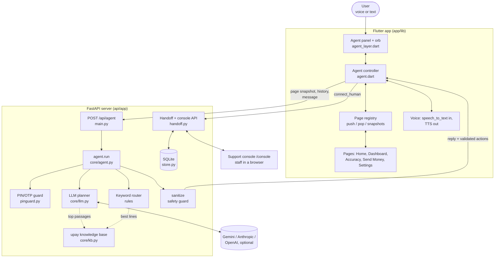
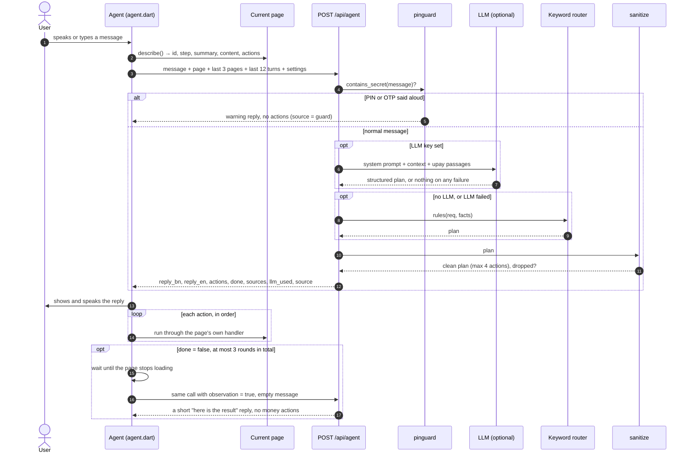
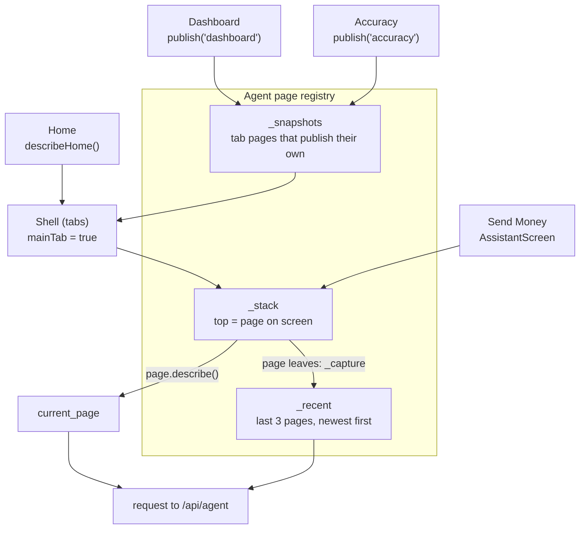
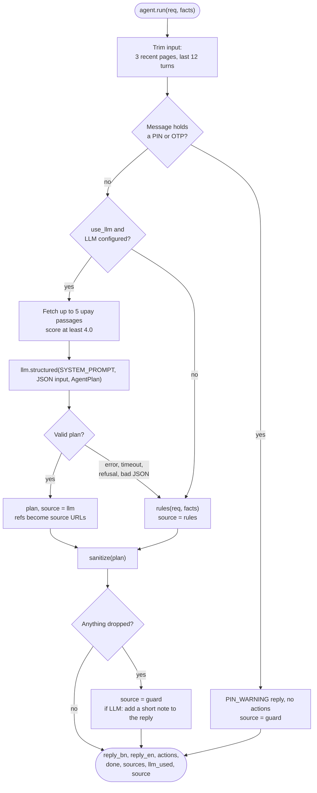
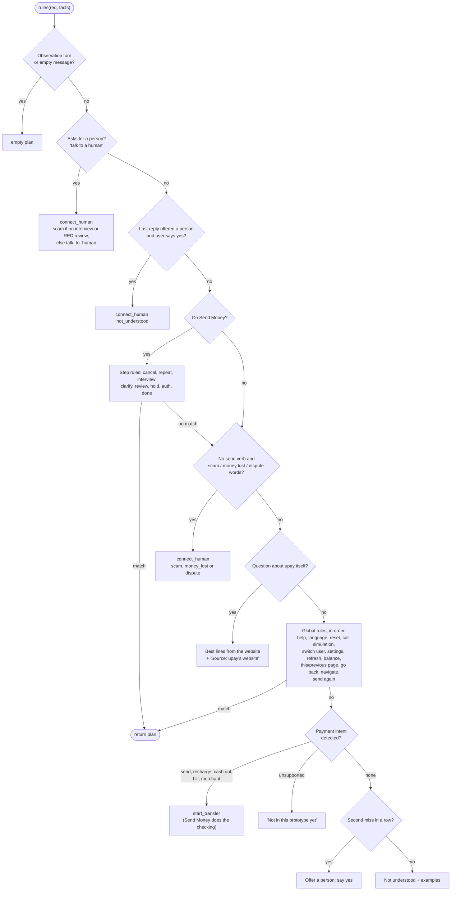
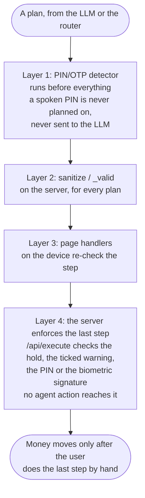
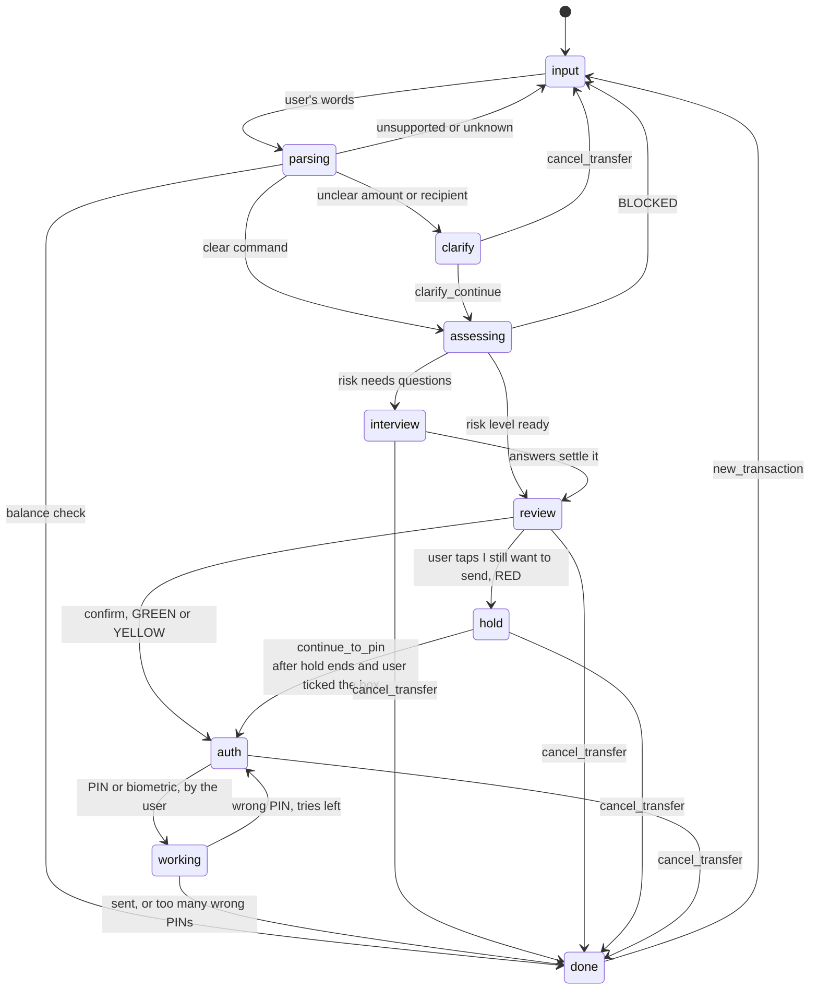
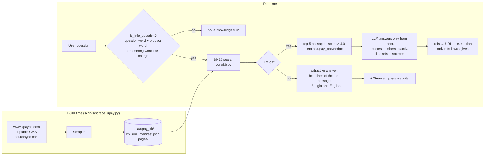
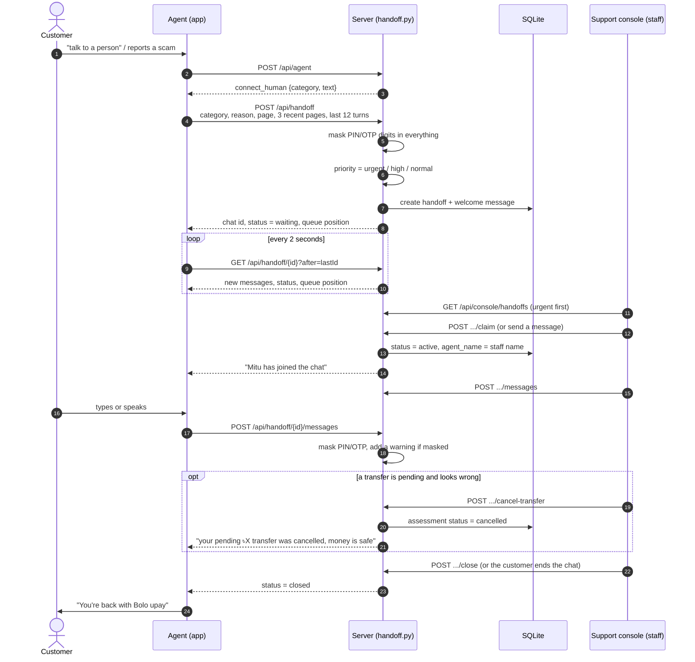
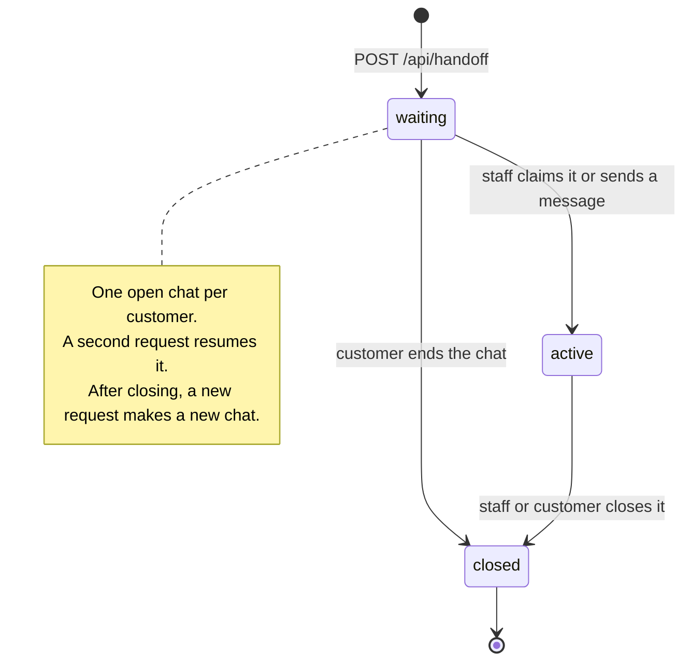

# Bolo agent: how it works

The Bolo agent is the voice and text assistant that lives on every page of the Bolo upay app. You say "ড্যাশবোর্ড খোলো", "আম্মুকে ৫০০ টাকা পাঠাও" or "cash out er charge koto?" and it opens the page, starts the checked transfer or answers from upay's website. When it cannot help, or you report a scam, it hands the chat to a person.

This page is the one place that explains the whole feature. Everything here is taken from the code; file paths are given so you can check.

> Prototype only. Not the official upay app, no real money, synthetic data.

**Contents**

1. [Terms: three things called "agent"](#1-terms-three-things-called-agent)
2. [The big picture](#2-the-big-picture)
3. [One turn, step by step](#3-one-turn-step-by-step)
4. [What the agent can see: pages and snapshots](#4-what-the-agent-can-see-pages-and-snapshots)
5. [What the agent can do: the action catalogue](#5-what-the-agent-can-do-the-action-catalogue)
6. [The two planners: LLM and keyword router](#6-the-two-planners-llm-and-keyword-router)
7. [The safety guard](#7-the-safety-guard)
8. [Send Money: steps and what the agent may do in each](#8-send-money-steps-and-what-the-agent-may-do-in-each)
9. [Answering questions about upay (RAG)](#9-answering-questions-about-upay-rag)
10. [Human handoff and the support console](#10-human-handoff-and-the-support-console)
11. [API reference](#11-api-reference)
12. [Configuration](#12-configuration)
13. [Failure behaviour](#13-failure-behaviour)
14. [Privacy](#14-privacy)
15. [Code map](#15-code-map)
16. [Tests](#16-tests)
17. [How to extend it](#17-how-to-extend-it)
18. [Known limits](#18-known-limits)

---

## 1. Terms: three things called "agent"

| Name in this repo | What it is | Where |
|---|---|---|
| **Bolo agent** | The AI assistant in the app. This document. | `api/app/core/agent.py`, `app/lib/agent/` |
| **upay agent** (cash-in/cash-out agent) | A real upay shop or field agent where people deposit and withdraw cash. Not software here. The Bolo agent only *knows about them* through the knowledge base, and Cash Out asks "which agent". | `data/upay_kb/` |
| **Support agent / staff** | A person who answers a handed-off chat in the support console. The code field is `agent_name`. | `api/app/handoff.py`, `app/lib/console/` |

## 2. The big picture



The design rests on three ideas:

1. **The page describes itself.** Every page tells the agent what it shows and which actions its buttons offer *right now*. The agent never guesses what is on screen.
2. **The agent acts through the buttons' own code.** An action like `confirm` calls the same method the Confirm button calls. There is no second path.
3. **Every plan is cleaned by one safety function.** It does not matter whether an LLM or the keyword router wrote the plan: `sanitize()` runs on both, and the agent has no action for entering a PIN, using biometrics, ticking the RED warning box or skipping a hold.

## 3. One turn, step by step



What each step does:

| # | Step | Detail |
|---|---|---|
| 1 | Capture | Speech is turned into text on the device (`speech_to_text`; Web Speech API on web). The final transcript is sent automatically. Typing works too. |
| 2 | Describe | The current page returns a snapshot (see section 4). The last 3 pages the user left are included, newest first. |
| 3 | Send | `Api.agent()` posts to `/api/agent` with the session token. The user is the one in the token, never a field in the body. |
| 4 | PIN guard | If the message looks like a PIN or OTP, the turn stops here with a warning. The LLM never sees it. |
| 5 | Plan | LLM if configured and it answers, otherwise the keyword router. |
| 6 | Sanitize | Unknown, unoffered or unsafe actions are dropped. See section 7. |
| 7 | Reply | The app shows the reply in the language the user will have *after* the actions (so "speak English" is answered in English) and speaks it. |
| 8 | Act | Actions run in order; each adds a tick label (for example "Amount selected") to the message. |
| 9 | Observe | If the plan says `done: false` (for example after `start_transfer`, so it can read out the risk check), the app waits for the page to finish (400 ms plus up to 25 × 300 ms while the step is `parsing`, `assessing` or `working`) and calls again with `observation: true`. Three rounds at most. |

## 4. What the agent can see: pages and snapshots

Pages register themselves in a stack when they open and leave it when they close (`Agent.push` / `Agent.pop` in `app/lib/agent/agent.dart`). Whenever a page changes, it calls `Agent.touch()`, so its next snapshot is current. When a page is left, its last snapshot goes into a list of the 3 most recent pages.



One snapshot looks like this (`AgentPage` in `api/app/main.py`):

```json
{
  "id": "assistant",
  "step": "review",
  "summary_bn": "RED: সেন্ড মানি, নতুন নম্বর, ৳৫,০০০ ...",
  "summary_en": "RED: Send Money, ৳5,000 to a new number ...",
  "content": { "level": "RED", "amount": 5000, "reasons": [{ "bn": "...", "en": "..." }] },
  "actions": ["cancel_transfer", "repeat"]
}
```

| Field | Meaning |
|---|---|
| `id` | `home`, `dashboard`, `accuracy`, `assistant` (Send Money) or `settings` |
| `step` | Only Send Money has steps (section 8) |
| `summary_bn` / `summary_en` | A sentence or two the agent reads aloud when asked "what is on this page?" (up to 3,000 characters) |
| `content` | Structured details: amount, recipient candidates, risk level, reasons, hold seconds left |
| `actions` | The **page actions** the page's buttons offer right now. This is the allow-list for those actions (section 7) |

The main tab pages (Home, Dashboard, Accuracy) offer no page actions. Only the Send Money page does.

The agent panel (`app/lib/agent/agent_layer.dart`) is a non-blocking bottom sheet. On the main tabs the centre mic opens it; on pushed pages a floating orb does. It also shows a few tappable suggestions for the current step. During the scam interview it shows none, so the user's answers are never suggested to them.

## 5. What the agent can do: the action catalogue

There are 22 action types (`AgentAction` in `core/agent.py`). A plan carries at most **4**, run in order.

### Global actions (any page)

| Action | Arguments | What the app does | Extra server rule |
|---|---|---|---|
| `navigate` | `page`: home, dashboard, accuracy, assistant | Pops to the root, opens the tab or the Send Money page | Page must be one of the four |
| `go_back` | none | `Navigator.maybePop()` | none |
| `open_settings` | none | Opens the settings sheet | none |
| `refresh` | none | Reloads the page's data | none |
| `set_language` | `lang`: bn, en | Switches the app language | `lang` must be bn or en |
| `show_balance` | `on` | Shows or hides the balance | `on` must be a boolean |
| `set_simulate_call` | `on` | Turns the "phone call is active" simulation on or off | `on` must be a boolean |
| `switch_user` | `user_id` | Switches the demo user | Demo site only, known user id, needs the user's words |
| `reset_demo` | none | Resets demo data | Demo site only, and the message must contain "reset" |
| `start_transfer` | `text` | Hands the user's own words to the Send Money page, which parses, risk-checks and asks for confirmation | Needs the user's words, 1–300 characters |
| `connect_human` | `category`, `text` | Opens a chat with support staff (section 10) | Valid category, needs the user's words |

### Page actions (only if the page lists them in `actions`)

| Action | Arguments | What the Send Money page does |
|---|---|---|
| `select_amount` | `amount` (1 to 1,000,000) | Fills the amount field on the "which amount?" step |
| `select_recipient` | `contact_id` or `phone` | Picks a candidate or a number (`01[3-9]` + 8 digits) |
| `clarify_continue` | none | Continues to the risk check |
| `answer_interview` | `text` | Submits an answer to the scam question |
| `confirm` | none | Moves from review to the PIN step. Never on RED, never while a "did you mean" suggestion is open |
| `accept_suggestion` | none | Takes the suggested amount ("did you mean ৳350?") |
| `keep_amount` | none | Keeps the amount the user said |
| `continue_to_pin` | none | Moves from the hold to the PIN step, only after the hold ended **and** the user ticked the warning box by hand |
| `cancel_transfer` | none | Cancels the transfer |
| `new_transaction` | none | Starts over after a result |
| `repeat` | none | Reads the current question or result again |

### What is deliberately missing

There is **no action** for: entering a PIN, using biometrics, ticking the RED warning box, skipping the hold, or sending money directly. These stay with the user, always.

## 6. The two planners: LLM and keyword router



### The LLM path

- Active when `LLM_PROVIDER` and `LLM_API_KEY` are set (Anthropic, OpenAI or Gemini) and the request has `use_llm: true`.
- It gets a JSON document: the message, whether this is an observation turn, the user's language, the current page, up to 3 recent pages, the conversation, app settings, and facts (see [Privacy](#14-privacy)).
- It must return an `AgentPlan`: `reply_bn`, `reply_en`, `actions`, `done`, `sources`. The reply is one or two short sentences, read aloud, in both languages.
- The system prompt (`SYSTEM_PROMPT` in `core/agent.py`) lists the actions, the safety rules, how to answer upay questions only from `upay_knowledge`, and when to use `done=false`.
- Any failure (network, auth, rate limit, invalid JSON, refusal) returns nothing and the keyword router answers instead. The user does not notice.

### The keyword router (no LLM needed)

It understands Bangla, Banglish (Bangla in Latin letters) and English, and it knows which page and step it is on. Rules run in this order, and the first match wins:



Some behaviours worth knowing:

- **A person is always reachable.** Asking for one works on any page and any step.
- **Problems are not transfers.** "I was scammed", "my money is gone", "wrong number" go to a person, not to the transfer flow. But "ferot pathao 500" (send verb plus amount) still goes to the risk check.
- **A new command is not a confirmation.** On a review step, "karim ke 2000 pathao" is a new transfer, not a "yes" to the old one.
- **Yes and no are strict.** A bare "yes" is up to 5 words with nothing else in it (no amount, no name). Bangla, Banglish and English forms are all accepted.
- **Bangla suffixes** are handled ("ড্যাশবোর্ডে", "আম্মুকে", "dokaner ta") and relations resolve to contacts (ammu, baba, dokan, bou ...).

Examples (run against the real code, no LLM):

| User says | Page | Result |
|---|---|---|
| ড্যাশবোর্ড খোলো | Home | `navigate → dashboard` |
| আম্মুকে ৫০০ টাকা পাঠাও | Home | `start_transfer` with those words |
| amar pin 1234 | any | PIN warning, no actions (`source: guard`) |
| cash out er charge koto? | any | Charge lines from the website, with the source |
| talk to a person | any | `connect_human` (`talk_to_human`) |
| ami scammed hoyechi | any | `connect_human` (`scam`) |
| asdf qwer | any | "Sorry, I didn't understand" and examples |
| yes | Send Money, RED review | "I can't confirm it", reasons shown, no `confirm`, offers a person |
| yes | Send Money, GREEN review | `confirm`, "now enter your PIN" |

## 7. The safety guard

Safety is layered so that no single mistake, by the model or by the code, can move money.



### Layer 2: what `sanitize()` enforces

| Rule | Effect |
|---|---|
| Action type must be known (22 types) | Unknown types are dropped. A made-up `enter_pin` never survives |
| **Page actions must be offered by the page** | `confirm` on a RED review is dropped, because the page does not list it |
| **Money-moving actions need the user's own words** | `start_transfer`, `select_amount`, `select_recipient`, `clarify_continue`, `answer_interview`, `confirm`, `accept_suggestion`, `keep_amount`, `continue_to_pin`, `reset_demo`, `switch_user`, `connect_human` are dropped on observation turns and when there is no message |
| Arguments are validated and rebuilt | Only checked fields are kept; the rest of the object is discarded |
| `answer_interview` text is replaced by the **user's raw message** | The model cannot paraphrase or invent an answer to a scam question |
| Demo-only controls | `switch_user` and `reset_demo` exist only when `DEMO_MODE` is on |
| `reset_demo` needs the word "reset" in the user's message | |
| Limits | 4 actions, amount 1 to 1,000,000, text 300 characters, reply 600 characters, 3 sources |
| `done` | Forced to true when there are no actions, so an empty plan cannot loop |

If anything was dropped, the response has `source: "guard"`. If the LLM wrote the plan, a short note is added to the reply: "For your safety, that step is yours to do by hand."

### Layer 3: the app re-checks

Even if a bad action reached the device, the page handlers refuse it (`app/lib/screens/assistant.dart`):

- `confirm` only runs on the review step, not on RED, and not while a mistake suggestion is open.
- `continue_to_pin` only runs when the hold is over **and** the warning box is ticked.
- `answer_interview`, `select_*` and others only run on their own step.

### Spoken PIN or OTP

`api/app/core/pinguard.py` flags a 4–6 digit number within 4 tokens of a PIN, OTP, password, passcode or code word, in Bangla or English, including digits said one by one ("1 2 3 4"). An amount does not count: "pin lagbe na, 2000 taka pathao" is fine. The agent replies with a warning and the helpline (16268) and does nothing else. In the human chat the digits are masked instead (section 10).

## 8. Send Money: steps and what the agent may do in each

Send Money is the only page with page actions. Its snapshot's `step` and `actions` are the contract between the page and the agent (`_describe()` in `assistant.dart`).



| Step | Page actions offered | Agent may | Agent may **not** |
|---|---|---|---|
| `input` | none | `start_transfer` (global) | n/a |
| `parsing`, `assessing`, `working` | none | wait | everything |
| `clarify` | `select_amount` (if the amount is unclear), `select_recipient` (if the recipient is unclear), `clarify_continue`, `cancel_transfer`, `repeat` | pick by word ("the first", "dokan"), by phone number or by amount | guess when the user did not say |
| `interview` | `answer_interview`, `cancel_transfer`, `repeat` | pass the user's own answer | write or suggest an answer |
| `review` | `confirm` (not on RED, not with a mistake), `accept_suggestion` and `keep_amount` (only with a mistake), `cancel_transfer`, `repeat` | confirm GREEN and YELLOW on the user's "yes"; explain RED | confirm a RED transfer |
| `hold` | `continue_to_pin` (only when ready), `cancel_transfer`, `repeat` | continue when the user did the box and the timer is done | tick the box, skip the timer |
| `auth` | `cancel_transfer` | explain that the user enters the PIN | enter or see a PIN, use biometrics |
| `done` | `new_transaction`, `repeat` | start over | n/a |

Two things link the agent to the scam shield:

- **Scam context.** The agent remembers the user's last 3 utterances and passes them to the Send Money page (`scamContext`), so "upay office called me ... send 5000 to 017..." still counts as a call from "upay" even if only the second part is sent on as the command.
- **RED is a dead end for the agent.** On a RED review a "yes" gets the reasons, an explanation and an offer of a person. The user can still send, by tapping "I still want to send" themselves, then passing the 30-second hold and entering the PIN.

## 9. Answering questions about upay (RAG)

Questions about upay itself ("পিন ভুলে গেলে কিভাবে রিসেট করব?", "send money limit koto", "হেল্পলাইন নম্বর কত") are answered from **upay's public website**, never from the model's memory.



**Source data.** `data/upay_kb/manifest.json` records the crawl: 458 passages from 15 site pages and 159 CMS pages (crawled 2026-10-07). Each passage has its URL, title, section and category. Re-run the scraper to refresh it (about 10 seconds).

**Retrieval** (`api/app/core/kb.py`) is plain BM25 with no embeddings and no extra dependencies:

- Terms use the same normaliser as the parsers.
- Light Bangla suffix stripping (গুলো, দের, কে, টা ...) and English plural stripping.
- A small glossary maps Bangla and Banglish to the English words the site uses ("চার্জ", "khoroch" → charge), so a query in any script reaches both halves of a bilingual passage.
- Query-side hints: "helpline" also searches `16268 call talk`.
- Charge and limit questions boost the charges and limits tables; press articles and offers are down-weighted.
- Duplicate passages are collapsed.

**Without an LLM** the extractive answer takes the best lines of the top passage in the user's language, rebuilds table rows with their header ("Daily Transaction Limit: Send Money | 50 | 50,000"), keeps each FAQ question with its answer, and adds the source. If nothing scores at least 4.0 it says nothing, and the turn falls through to the other rules.

**Commands are not hijacked.** A question needs a question word plus a product word, no amount and no phone number. "ammu ke 500 pathao" and "cash out 500" still start a transfer.

**Never guesses.** With the LLM, if the passages do not answer, the prompt tells it to say it does not know and suggest the helpline 16268. Offers end, so it points to the website for the latest.

Debug endpoint: `GET /api/kb/search?q=...&k=5` (signed-in users). `GET /api/health` reports `kb_chunks`.

## 10. Human handoff and the support console

### When the agent hands over

| Trigger | Category | How it is detected |
|---|---|---|
| User asks for a person on any page | `talk_to_human` (or `scam` if mid-interview or on a RED review) | Router phrase list; the LLM follows the prompt |
| "I was scammed", "প্রতারণা", "thokaise" | `scam` | Router word list |
| "my money is gone", "টাকা চলে গেছে" | `money_lost` | Router word list |
| "wrong number", "refund", "অভিযোগ" | `dispute` | Router word list |
| Second misunderstanding in a row, and the user says yes to "talk to a person?" | `not_understood` | Router (`OFFER_HUMAN`) |
| Anything else | `other` | LLM only |

### The flow



While a chat is open, what the user says goes to the person, not to the agent (`Agent.send` checks `chat != null`). The chat is dropped if the demo user is switched.

### Chat status



### Priority and queue

| Priority | Set when |
|---|---|
| `urgent` | category `scam` or `money_lost`, or the page showed a RED level, or a RED check in the last hour |
| `high` | category `dispute`, or a YELLOW level, or a YELLOW check in the last hour |
| `normal` | everything else |

The queue is sorted by priority, then by age. Staff see the list with status order waiting, active, closed, then priority, then age; closed chats keep the latest 50.

### What staff see

The console (`app/lib/console/`, served at `/console`) shows the queue and chat, plus the context the bot handed over: what the customer said, the page and step they were on, recent pages, the bot conversation, their last 8 scam-shield checks (level, reasons, answers, new recipient, on a call) and their recent transactions, with phone numbers masked.

### What staff can and cannot do

| Can | Cannot |
|---|---|
| Claim, reply, close | Send money |
| Stop the customer's **own pending** transfer (`cancel-transfer`) | Approve or release a held transfer |
| Read the context above | Read or change a PIN (PINs typed in the chat are masked before they are stored) |

Staff sign in with named accounts (`CONSOLE_STAFF="Mitu:<password or bcrypt hash>,Rafi:..."`), and the name stored on a chat is the signed-in account, not something the browser sends. Without `CONSOLE_STAFF`, a shared `CONSOLE_TOKEN` works. The public default code `support-demo` is accepted only when `DEMO_MODE` is on.

## 11. API reference

All endpoints below take the signed-in user from the bearer token.

### `POST /api/agent`

Request (`AgentIn`):

| Field | Type | Notes |
|---|---|---|
| `message` | string, max 500 | What the user said. Empty on an observation turn |
| `page` | `AgentPage` | The current page snapshot (section 4) |
| `recent_pages` | `AgentPage[]` | Up to 3 used, newest first, without the current page |
| `history` | `{role: user|agent, text}[]` | Last 12 used |
| `bangla` | bool | The user's language |
| `settings` | object | `simulate_call`, `balance_visible`, `user_id` |
| `observation` | bool | An automatic follow-up after the app ran actions |
| `use_llm` | bool, default true | Set false to force the keyword router |

Response:

| Field | Meaning |
|---|---|
| `reply_bn`, `reply_en` | The reply in both languages |
| `actions` | Validated actions, at most 4 |
| `done` | `false` means: look at the page again and report the result |
| `sources` | Website passages the answer is based on: `{url, title, section}`, at most 3 |
| `llm_used` | Whether an LLM wrote the plan |
| `source` | `llm`, `rules` or `guard` |

Facts the server adds (`main.py: agent_turn`): the user with live balance, recent transactions, `demo` flag, and, **only on a demo site**, the list of demo users and the ops numbers.

### Other endpoints the agent touches

| Method and path | Who | Purpose |
|---|---|---|
| `GET /api/kb/search?q=&k=` | signed-in | Search the knowledge base |
| `POST /api/tts` | signed-in | Natural voice for replies (Gemini TTS) |
| `POST /api/handoff` | customer | Start or resume a chat with a person |
| `GET /api/handoff/{id}?after=` | customer | Poll for new messages |
| `POST /api/handoff/{id}/messages` | customer | Send a message (PIN masked) |
| `POST /api/handoff/{id}/close` | customer | End the chat |
| `POST /api/console/login` | staff | Sign in |
| `GET /api/console/handoffs`, `GET .../{id}` | staff | Queue and detail with context |
| `POST /api/console/handoffs/{id}/claim`, `/messages`, `/close` | staff | Work a chat |
| `POST /api/console/handoffs/{id}/cancel-transfer` | staff | Stop a pending transfer |

## 12. Configuration

| Variable | Effect on the agent |
|---|---|
| `LLM_PROVIDER` | `anthropic`, `openai` or `gemini`. Empty means the keyword router only |
| `LLM_API_KEY` | The provider key. Both must be set for the LLM path |
| `LLM_MODEL` | Optional override. Defaults: `claude-opus-5-5`, `gpt-4o-mini`, `gemini-2.5-flash` |
| `DEMO_MODE` | Turns on `switch_user`, `reset_demo` and the demo facts |
| `CONSOLE_STAFF`, `CONSOLE_TOKEN`, `STAFF_SESSION_MINUTES` | Support console accounts and session length (default 480 minutes) |
| `SESSION_MINUTES` | Customer session length (default 30) |

The LLM call has a 30-second timeout (Anthropic calls also use low effort). The full variable list is in the README, section 6.

## 13. Failure behaviour

| What goes wrong | What the user sees | Why it is safe |
|---|---|---|
| No LLM key, or LLM down, slow, rate-limited, refused or returns bad JSON | The keyword router answers. Same actions, same guard | The router is the complete fallback, not a degraded mode |
| LLM proposes an unsafe or unoffered action | The action is silently dropped and a note is added: "that step is yours to do by hand" | `sanitize()` runs on every plan |
| User says a PIN or OTP | A warning and the helpline, nothing else | Detected before the LLM or the router |
| Agent does not understand | Example phrases; on the second miss it offers a person | Never guesses a transfer |
| Server unreachable | "Cannot reach the server." | No action runs |
| Server error | "Something went wrong." | No action runs |
| Knowledge base file missing | The index is empty and knowledge answers are skipped | The agent still works for everything else |
| Page handler missing or step changed | The action does nothing and shows no tick | Handlers re-check the step |
| Chat with a person closes, or returns 409 | The agent says "You're back with Bolo upay" | Chat state is cleared |

More on model and risk failures: [`FAILURE_POLICY.md`](FAILURE_POLICY.md).

## 14. Privacy

What the LLM receives (`_llm_input` in `core/agent.py`):

- The message, the current and recent page snapshots, the last 12 turns and the settings.
- The user's id, name, **masked** phone and balance; contacts with **masked** phones; saved bill accounts (name and category, no account numbers); the last 8 transactions with the contact name or a masked number.
- On a demo site only: the other demo users' names and the ops numbers.
- Up to 5 website passages, only on turns where the user said something.

What it never receives: a PIN or OTP (stopped first) or a full phone number. On observation turns it gets no website passages.

Audio stays on the device (speech-to-text runs on the phone or in the browser). The app never listens to phone calls and never uses voice biometrics.

For production the plan is a local model so no customer text leaves upay's servers (see the README, "LLM today, local model in production"). Nothing depends on the LLM: with it off, the keyword router and the device voice take over.

## 15. Code map

| Area | File | What is in it |
|---|---|---|
| Server entry | `api/app/main.py` | `AgentIn`, `AgentPage`, `agent_turn` (`/api/agent`), facts builder |
| Agent brain | `api/app/core/agent.py` | actions, `rules`, `sanitize`, `SYSTEM_PROMPT`, `run` |
| LLM adapter | `api/app/core/llm.py` | `structured()` for Anthropic, OpenAI, Gemini; returns None on failure |
| PIN guard | `api/app/core/pinguard.py` | `contains_secret`, `mask` |
| Knowledge | `api/app/core/kb.py`, `scripts/scrape_upay.py`, `data/upay_kb/` | BM25, glossary, extractive answers, the crawl |
| Intent and numbers | `api/app/core/intent.py`, `parser.py`, `numbers.py`, `contacts.py`, `text.py` | Used by the router to detect payments, amounts, recipients |
| Handoff | `api/app/handoff.py`, `api/app/store.py` | Chats, messages, priority, queue, console routes, SQLite tables `handoffs`, `handoff_messages` |
| App controller | `app/lib/agent/agent.dart` | Page registry, conversation loop, action runner, handoff client |
| App UI | `app/lib/agent/agent_layer.dart` | Orb, bottom panel, suggestions, unread badge |
| Pages | `app/lib/screens/assistant.dart`, `home.dart`, `insights.dart`, `app/lib/main.dart` | `describe()`, handlers, `touch()` |
| Voice | `app/lib/services/voice.dart` | Speech in, speech out (Gemini TTS, device voice fallback) |
| API client | `app/lib/api.dart` | `Api.agent`, `Api.startHandoff`, `Api.pollHandoff`, ... |
| Support console | `app/lib/console/` | The staff web app |

## 16. Tests

Backend tests live in `api/tests/` (run from `api/` with `pytest`).

| File | Covers |
|---|---|
| `test_agent.py` | Navigation, language, balance, switch user and reset rules, transfers going to the normal flow, clarify, review, mistake suggestion, interview answers verbatim, no confirm on RED, hold and PIN stay manual, spoken PIN, hostile plan dropped, observation turns cannot move money, LLM plan goes through the guard, LLM failure falls back |
| `test_kb.py` | Index built and cited, retrieval in three scripts, question detector, charge-table answers, search endpoint, upay answers with a source, questions do not hijack commands, LLM gets passages and cites only given refs, none on observation turns |
| `test_handoff.py` | Asking for a person, problem categories, second-miss offer, start/resume/poll, PIN masking, priority and queue order, staff sign-in, claim/close/new chat, stopping a pending transfer, no console route moves money or touches a PIN |

## 17. How to extend it

### Add a new global action (for example "open help")

1. Add the type to `AgentAction.type`, and to `GLOBAL_ACTIONS` in `core/agent.py`.
2. If it moves money or changes state the user must intend, add it to `USER_WORDS_ONLY`.
3. Add argument checks in `_valid()`. Rebuild the action from checked fields only.
4. Add a rule function and put it in `GLOBAL_RULES` so the router can produce it.
5. Describe it in `SYSTEM_PROMPT` so the LLM can use it.
6. Handle it in `Agent._run()` in `agent.dart` and add a tick label.
7. Add tests: the plan, the guard dropping it when it should, and the LLM path.

### Add a new page-level action

1. Same as above, but add it to `PAGE_ACTIONS` instead.
2. In the page's `_describe()`, list it in `actions` only in the state where it is allowed.
3. Add a handler in the page's `AgentPage(handlers: {...})` that **re-checks the state** and calls the same method the button calls.
4. Add router rules for the relevant step.

### Make a new page visible to the agent

1. Create an `AgentPage(describe: ..., handlers: ...)`.
2. `Agent.instance.push(page)` in `initState` and `pop(page)` in `dispose`.
3. Call `Agent.instance.touch()` whenever the page's state changes (overriding `setState` as Send Money does is the simplest way).
4. Add the page id to `PAGES` and `PAGE_LABEL` if the agent should be able to open it.

### Add knowledge

Add a page to `scripts/scrape_upay.py` or run it again, then check `GET /api/kb/search?q=...`. To make a new Banglish word searchable, add it to `GLOSSARY` in `core/kb.py`.

## 18. Known limits

- **Rule-based Banglish is best effort.** Unusual phrasings fall through to "not understood" and an offer of a person. The LLM path is looser but still guarded.
- **The charge calculator on upay's site is English only**, so a Bangla charge question can surface a related Bangla page first. The LLM path sees both.
- **Offers and charges change.** Answers cite the page; the crawl date is in the manifest.
- **Polling, not push.** The handoff chat polls every 2 seconds.
- **Demo-scale storage.** SQLite is used; the chat queue and priority rules are simple.
- **Only the Send Money page has page actions.** Home, Dashboard and Accuracy can be described and refreshed but not driven further.
- **The agent never executes a payment.** That is intentional, not a gap.
